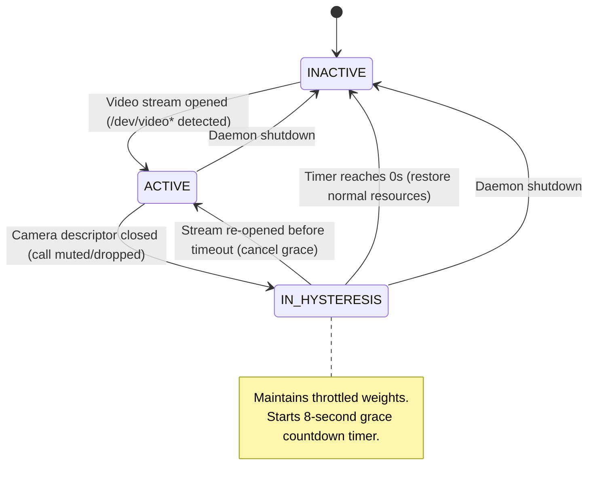

# Interactive Session Protector: Architecture & Algorithm Design

This document details the architectural design, algorithmic workflows, and operating system primitives powering the **Interactive Session Protector (ISP)**.

---

## 1. Executive Summary & Surface-Level Overview

### The Problem
Modern desktop Operating Systems treat latency-critical interactive tasks (such as video conferencing, live telemedicine, proctored exams, or gaming) with standard **Completely Fair Scheduling (CFS)** priority. 

When heavy background workloads execute concurrently—such as:
- Code compilation (`gcc`, `g++`, `rustc`, `make`, `ninja`)
- Game engines & heavy rendering (Unity, Unreal Engine, Blender)
- Large file compression (`tar`, `xz`, `gzip`)
- Package management & background updates (`apt`, `dpkg`)
- Game clients & heavy background utilities (Steam, Wine, Lutris)

...the operating system's CPU scheduler, memory bus, and block I/O queues become saturated. This causes:
1. **Audio Latency & Buffer Underruns**: Distorted or robotic voices.
2. **Video Frame Deadline Misses**: Dropped webcam frames and choppy playback (>100ms frame intervals).
3. **Network Jitter**: Delayed processing of real-time UDP/WebRTC network packets.

### The Solution
The **Interactive Session Protector (ISP)** is an autonomous user-space OS daemon that operates without kernel modifications or application patching. It runs silently in the background, detects when a user begins an interactive session (e.g. turning on a webcam or starting a video call), dynamically re-architects the Linux `cgroups v2` hierarchy, and shapes system resources:

- **Guarantees Protected Resources**: The interactive session and all its child/helper processes are granted a boosted CPU weight of **800 shares** and elevated I/O priority.
- **Throttles Contending Background Tasks**: Background batch jobs, compilers, and games are dynamically moved into a throttled slice with a CPU weight of **1–20 shares**, I/O priority downgraded to **IDLE**, and memory pressure limits enforced.
- **Enforces Hard CFS Bandwidth Limits (`cpu.max`)**: On modern 8–24 core CPUs, background tasks are hard-clamped to an absolute bandwidth quota (e.g., **5% of a single core**), guaranteeing that idle cores cannot be exploited to starve the system.
- **Prevents Starvation (Anti-Starvation Aging)**: Throttled background processes are dynamically aged over time so they never deadlock or freeze completely.
- **Suppresses Flapping (Hysteresis)**: An 8-second grace period prevents rapid state oscillation when users temporarily toggle video or switch cameras.

---

## 2. High-Level System Architecture

The daemon follows a decoupled, multi-threaded pipeline:

```
                      ┌───────────────────────────────────────┐
                      │        Linux Kernel & Subsystems      │
                      │  (/proc, V4L2 Webcam, cgroups v2, IO) │
                      └──────────────────┬────────────────────┘
                                         │
                   ┌─────────────────────┴─────────────────────┐
                   │                                           │
                   ▼                                           ▼
       ┌───────────────────────┐                   ┌───────────────────────┐
       │   Session Detector    │                   │   Process Table       │
       │  (V4L2 Scanner &      │                   │  (Tree Walker &       │
       │   Stream Monitoring)  │                   │   Pattern Classifier) │
       └───────────┬───────────┘                   └───────────┬───────────┘
                   │                                           │
                   │ Active / Inactive                         │ Process Tree Taxonomies
                   │ State Events                              │ (Protected vs Background)
                   │                                           │
                   └─────────────────────┬─────────────────────┘
                                         │
                                         ▼
                       ┌───────────────────────────────────┐
                       │      Resource Shaper Engine       │
                       │   - Hysteresis State Machine      │
                       │   - Anti-Starvation Aging         │
                       │   - Weight & Quota Calculation    │
                       └─────────────────┬─────────────────┘
                                         │
                                         ▼
                       ┌───────────────────────────────────┐
                       │        Cgroup v2 Manager          │
                       │   - protector.slice Hierarchy     │
                       │   - CFS cpu.weight & cpu.max      │
                       │   - ioprio_set (IDLE Class)       │
                       │   - Migration Tracking & Restore  │
                       └─────────────────┬─────────────────┘
                                         │
                   ┌─────────────────────┴─────────────────────┐
                   │                                           │
                   ▼                                           ▼
       ┌───────────────────────┐                   ┌───────────────────────┐
       │   Status & Command    │                   │   Dear ImGui Overlay  │
       │   IPC Layer           │                   │   Floating HUD        │
       │  (/tmp/protector.*)   │                   │  (Real-Time Visuals)  │
       └───────────────────────┘                   └───────────────────────┘
```

### Architectural Subsystems

| Subsystem | Source Files | Primary Responsibility |
| :--- | :--- | :--- |
| **Session Detector** | `include/session_detector.hpp`<br>`src/session_detector.cpp` | Scans `/proc/[pid]/fd/*` symlinks for hardware video capture nodes (`/dev/video*`) and audio endpoints. |
| **Process Table** | `include/proc_table.hpp`<br>`src/proc_table.cpp` | Maintains a thread-safe registry of all running processes, walks parent-child process trees (`PPID`), and classifies processes. |
| **Resource Shaper** | `include/resource_shaper.hpp`<br>`src/resource_shaper.cpp` | Manages the three-state lifecycle (`INACTIVE`, `ACTIVE`, `IN_HYSTERESIS`) and computes dynamic weights with anti-starvation aging. |
| **Cgroup v2 Manager** | `include/cgroup_manager.hpp`<br>`src/cgroup_manager.cpp` | Manipulates the unified Linux `cgroups v2` filesystem (`protector.slice`), writes `cpu.weight`, `cpu.max`, and sets I/O priority via `ioprio_set`. |
| **Protector Daemon** | `include/daemon.hpp`<br>`src/daemon.cpp` | Coordinates background threads (`monitor_thread` and `shaper_thread`), handles SIGHUP/SIGTERM, and manages IPC commands. |
| **Overlay Renderer** | `include/overlay.hpp`<br>`src/overlay/*` | Provides an interactive, hardware-accelerated Dear ImGui HUD displaying real-time allocation bars, process tables, and QoS sliders. |

---

## 3. Formal Operating System (OS) Algorithms & Theoretical Concepts Used

The Interactive Session Protector is built upon core Operating Systems principles and classical algorithms taught in standard academic OS curricula (e.g., *Silberschatz, Galvin & Gagne's Operating System Concepts* and *Tanenbaum's Modern Operating Systems*).

### Academic OS Algorithm Mapping Matrix

| Functionality in Project | Formal OS Algorithm / Principle | Standard OS Subject Domain | Textbook Reference |
| :--- | :--- | :--- | :--- |
| **CPU Share Balancing** (`cpu.weight`) | **Weighted Fair Queueing (WFQ) / Proportional Share Scheduling** | CPU Scheduling | Silberschatz §5.3 / Tanenbaum §2.4 |
| **Hard Bandwidth Clamping** (`cpu.max`) | **Token Bucket / Bandwidth Reservation Quota (CBS)** | Real-Time & Multimedia QoS | Silberschatz §5.6 |
| **Anti-Starvation Floor & Aging** | **Priority Aging Algorithm (Anti-Starvation)** | Starvation & Deadlock Prevention | Silberschatz §5.3.2 |
| **Camera State Flapping Prevention** | **Dual-Threshold Hysteresis (Thrashing Prevention)** | OS State Transitions & Control | Schedutil / CPU Governors |
| **Disk I/O Prioritization** (`ioprio_set`) | **Multi-Class Strict Priority Scheduling (CFQ/BFQ Idle Class)** | Secondary Storage & Disk I/O | Silberschatz §10.4 / Tanenbaum §5.4 |
| **Browser Multi-Process Tree Resolution** | **Process Hierarchy Tree Traversal (Ancestral DFS/BFS)** | Process Management & Process Trees | Silberschatz §3.1 – §3.3 |
| **Memory Pressure Management** (`memory.high`) | **Working Set Model & Proportional Page Reclaim Throttling** | Virtual Memory Management | Silberschatz §9.6 (Denning's Model) |
| **Daemon Inter-Thread Sync** | **Hoare/Mesa Monitor Pattern with Condition Variables** | Process Synchronization & Mutexes | Silberschatz §6.7 |
| **Single-Instance Daemon Lock** | **Advisory File-Lock Mutual Exclusion (`flock`)** | Concurrency & File System Locks | Tanenbaum §6.2 |

---

### Algorithm 1: Hardware-Driven Session Detection via ProcFS Inode Traversal
*(OS Domain: File Systems, Inodes, & Character Device Management)*

#### Objective
Detect when any video conferencing application (browser or native desktop client) activates the webcam, with zero false positives and minimal CPU overhead.

#### OS Primitive
Linux Video4Linux2 (`V4L2`) device character nodes (`/dev/video0` .. `/dev/video63`).

#### Algorithmic Flow
```mermaid
flowchart TD
    Start([Periodic Polling 500-1000ms]) --> ScanProc[Iterate over /proc/[pid] entries]
    ScanProc --> FilterPIDs{Is PID numeric & readable?}
    FilterPIDs -- No --> NextPID[Skip PID]
    FilterPIDs -- Yes --> CheckFDs[Read directory /proc/[pid]/fd]
    CheckFDs --> ScanFDLinks[Call readlink on each file descriptor]
    ScanFDLinks --> MatchTarget{Target matches /dev/video*?}
    MatchTarget -- Yes --> RecordActive[Mark PID as Active Video Session]
    MatchTarget -- No --> NextFD[Check next fd]
    RecordActive --> CheckTree[Resolve Parent Process & Child Helpers]
    CheckTree --> EmitState[Emit Active State Event to Shaper Engine]
```

1. **ProcFS Traversal**: On every poll interval (default: `1000ms`), the detector iterates through `/proc` for numeric subdirectories.
2. **File Descriptor Inspection**: For each process, it opens `/proc/<pid>/fd/` and reads target paths of symlinks using `readlink()`.
3. **Device Node Matching**: Compares targets against the configured device path prefix (e.g. `/dev/video*`).
4. **Resilience to Transient Errors**: If a process terminates during inspection, `ENOENT` or `EACCES` is caught gracefully without breaking the scan.

---

### Algorithm 2: Process Hierarchy Tree Traversal & Directed Graph Reachability (Ancestral DFS/BFS)
*(OS Domain: Process Management & Process Trees — Silberschatz §3.1 – §3.3)*

#### Objective
Ensure that multi-process applications (such as Chromium, Chrome, Firefox, Zoom, and Teams) are protected in their entirety, while identifying heavy background jobs and exempting system-critical services.

#### Taxonomy & Classification Rules

```
                      Process Identification
                               │
            ┌──────────────────┴──────────────────┐
            ▼                                     ▼
   System / Display Critical?            Holds /dev/video* fd?
   (Xorg, PipeWire, systemd)                      │
            │                                     ├─► Yes: PROTECTED
       [DO NOT TOUCH]                             │
                                                  └─► No: Check Ancestry & Name
                                                           │
                                        ┌──────────────────┴──────────────────┐
                                        ▼                                     ▼
                               Child of Protected App?               Matches Background Pattern?
                               (e.g., Chrome Renderer)               (gcc, unity, steam, tar)
                                        │                                     │
                                   [PROTECTED]                           [BACKGROUND]
```

1. **Category 1: `SYSTEM_CRITICAL` (Never-Touch)**
   - Hardcoded allowlist: `systemd`, `init`, `dbus-daemon`, `pipewire`, `wireplumber`, `pulseaudio`, `Xorg`, `wayland`, `gnome-shell`, `sshd`, and the `protector` daemon itself.
   - *Rule*: Never moved to any cgroup; never throttled.
2. **Category 2: `PROTECTED`**
   - Processes with an open descriptor to `/dev/video*`.
   - **Ancestral Tree Resolution**: Using `/proc/<pid>/stat` field 4 (`PPID`), the classifier walks upward to find the root session parent (e.g. `chrome`), and then walks downward (`get_descendants`) to protect all GPU helpers, audio sandboxes, and rendering threads.
3. **Category 3: `BACKGROUND` (Throttled Workloads)**
   - Identified by binary name (`comm`) and full command line (`/proc/<pid>/cmdline`).
   - Built-in patterns:
     - **Compilers & Build Systems**: `gcc`, `g++`, `cc1`, `cc1plus`, `clang`, `rustc`, `make`, `ninja`, `cargo`.
     - **Games & Game Engines**: `unity`, `unityhub`, `wine`, `steam`, `lutris`, `unreal`, `blender`.
     - **Heavy Batch Utilities**: `tar`, `gzip`, `xz`, `stress-ng`, `bg_workload`.
   - Supports live user-defined pattern extensions from the overlay UI or configuration file.

---

### Algorithm 3: Dual-Threshold Hysteresis State Transition Algorithm (Thrashing Prevention)
*(OS Domain: Dynamic Resource Governors, CPU Frequency Scaling & System State Stabilization)*

#### Objective
Prevent rapid oscillation ("flapping") of CPU and I/O weights when users toggle video mute, change breakout rooms, or switch cameras during a conference call.

#### State Transition Diagram



#### Mathematical Specification
Let $t_{\text{close}}$ be the timestamp when the last active video descriptor closes, and let $T_{\text{hysteresis}}$ be the configured grace period (default: 8.0 seconds).

The remaining hysteresis duration at time $t$ is defined as:
$$\Delta t_{\text{remain}}(t) = \max\left(0, T_{\text{hysteresis}} - (t - t_{\text{close}})\right)$$

- If a new video stream is detected at $t < t_{\text{close}} + T_{\text{hysteresis}}$, the countdown is aborted and the state returns immediately to `ACTIVE`.
- Background tasks remain throttled during `IN_HYSTERESIS`, guaranteeing that momentary camera blinks do not cause background workloads to spike and drop audio frames.

---

### Algorithm 4: Proportional Share Scheduling (Weighted Fair Queueing) & Token Bucket Bandwidth Quota (CBS)
*(OS Domain: CPU Scheduling & Multimedia QoS — Silberschatz §5.3, §5.6 / Tanenbaum §2.4)*

#### Theoretical Model
1. **Generalized Processor Sharing (GPS) / Weighted Fair Queueing (WFQ)**:
   In classical OS scheduling theory, proportional share scheduling allocates CPU processing time to each process $i$ in direct proportion to its assigned weight $w_i$:
   $$\text{Share Ratio}_i = \frac{w_i}{\sum_{j} w_j}$$
   In the Linux Completely Fair Scheduler (CFS), this is governed by `cpu.weight` ($1 \le w \le 10000$).
   
2. **Work-Conserving vs. Non-Work-Conserving Schedulers**:
   CFS is naturally *work-conserving* — if idle CPU cycles exist on any CPU core, runnable threads are scheduled immediately. On modern multi-core processors (e.g. 14–24 cores), an interactive video call only occupies 1–2 cores. Proportional share scheduling alone allows background jobs (such as multi-threaded compiles or games) to consume 100% of the remaining cores, generating cache contention and power/thermal throttling without visibly lagging the background tasks.

3. **Constant Bandwidth Server (CBS) / Token Bucket Bandwidth Quota**:
   To enforce hard real-time QoS guarantees, the OS scheduler is switched to a *non-work-conserving quota model* using `cpu.max` (implementing a token bucket with quota $Q$ and period $T$):
   $$\text{Maximum CPU Bandwidth} = \frac{Q}{T}$$

#### The Dual-Tier Clamping Architecture

```
┌────────────────────────────────────────────────────────────────────────┐
│                        RESOURCE SHAPING TIERS                          │
├───────────────────────────────────┬────────────────────────────────────┤
│ 1. Proportional CFS Weight (WFQ)  │ 2. Hard CFS Bandwidth Quota (CBS)  │
│    (cpu.weight)                   │    (cpu.max)                       │
├───────────────────────────────────┼────────────────────────────────────┤
│ Protected:  800 shares            │ Protected:  max (unrestricted)     │
│ Normal:     100 shares (default)  │ Normal:     max (unrestricted)     │
│ Background: 1 - 20 shares         │ Background: 5,000 / 100,000        │
│                                   │             (5% of ONE core hard)  │
└───────────────────────────────────┴────────────────────────────────────┘
```

#### Bandwidth Quota Implementation (`cpu.max`)
The bandwidth quota is configured as `"quota period"` in microseconds:
$$\text{period} = 100{,}000\,\mu\text{s}\quad(100\,\text{ms})$$
$$\text{quota} = \left(\frac{\text{percent}}{100}\right) \times \text{period}$$

- When `background_cpu_max_percent = 5`, quota is set to `5000 100000`.
- The Linux kernel scheduler strictly caps all background threads combined to **5% of a single CPU core**, causing background tasks to visibly crawl and drop throughput by >95%, demonstrating undeniable OS-level resource control.

---

### Algorithm 5: Priority Aging Algorithm for Anti-Starvation & Priority Inversion Prevention
*(OS Domain: CPU Scheduling, Starvation Avoidance & Priority Inversion — Silberschatz §5.3.2)*

#### The Starvation Problem
A classic failure mode in strict priority scheduling or aggressive proportional throttling is **indefinite starvation**: low-priority background threads never receive enough CPU cycles to complete their tasks or release kernel resources. If a heavily throttled process holds a lock or IPC socket needed by an interactive component, **priority inversion** occurs.

#### Algorithmic Formulation (Priority Aging)
The Interactive Session Protector implements dynamic **priority aging**. When an interactive session begins (`ACTIVE`), the background weight is reduced to the baseline starvation floor $W_{\text{floor}}$ (default: 5 or 20 shares).

Every $T_{\text{aging}}$ interval (default: 15 seconds), the daemon raises the background priority by $\Delta_{\text{aging}}$ (default: +10 shares), bounded by an aging ceiling $W_{\text{ceiling}}$ (default: 100 shares):

$$W_{\text{bg}}(k) = \min\left(W_{\text{ceiling}},\, W_{\text{floor}} + k \cdot \Delta_{\text{aging}}\right)$$

Where:
- $k = \left\lfloor \frac{t - t_{\text{active}}}{T_{\text{aging}}} \right\rfloor$ is the number of aging epochs elapsed.
- When the interactive session terminates, the aging counter resets to zero and normal weights are restored.

---

### Algorithm 6: Multi-Class Strict Priority Disk I/O Scheduling (CFQ/BFQ Idle Class)
*(OS Domain: Secondary Storage Management & Disk I/O Scheduling — Silberschatz §10.4 / Tanenbaum §5.4)*

#### Objective
Prevent background disk I/O (e.g. database commits, `git` checkouts, `tar` decompression, package management) from congesting the block layer and inflating I/O queue wait times for video frame buffering and socket streams.

#### Multi-Class I/O Architecture
Linux disk schedulers (CFQ, BFQ, Kyber) divide disk requests into three primary priority classes:
1. **Real-Time (`IOPRIO_CLASS_RT`)**: Highest priority; served before all other requests.
2. **Best-Effort (`IOPRIO_CLASS_BE`)**: Standard user processes with 8 priority levels (0–7).
3. **Idle (`IOPRIO_CLASS_IDLE`)**: Served **only** when the disk queue has zero pending requests from any other class.

#### Kernel Mechanism (`ioprio_set`)
The daemon invokes the Linux `ioprio_set` system call via `SYS_ioprio_set`:
```cpp
syscall(SYS_ioprio_set, IOPRIO_WHO_PROCESS, pid, 
        IOPRIO_PRIO_VALUE(IOPRIO_CLASS_IDLE, 7));
```

- When classified into `background`, the daemon reassigns the process to `IOPRIO_CLASS_IDLE`.
- Background write throughput is strictly deferred whenever an interactive process reads or writes to disk.

---

### Algorithm 7: Atomic Process Migration, Scope Restoration & Orphan Evacuation
*(OS Domain: Process State Management & Resource Control Hierarchies)*

#### The Problem
Modern Linux distributions run user applications inside dynamic systemd transient scopes (e.g., `app-glib-unity\x2dhub-140391.scope`). 
1. Systemd scope names contain hex-encoded characters (`\x2d` represents `-`).
2. If a background process exits while inside `protector.slice/background`, or if its original transient scope terminates before restoration, attempting to restore the process or remove the directory fails with `EBUSY` ("Device or resource busy").

#### The Safe Restoration Algorithm
```cpp
void CgroupManager::cleanup() {
    // 1. Evacuate all lingering PIDs to root cgroup.procs
    std::ifstream procs_file(slice_path + "/background/cgroup.procs");
    pid_t pid;
    while (procs_file >> pid) {
        write_file("/sys/fs/cgroup/cgroup.procs", std::to_string(pid));
    }
    
    // 2. Reset cpu.max to remove bandwidth clamps
    write_file(slice_path + "/background/cpu.max", "max 100000");

    // 3. Remove child groups then slice
    rmdir(slice_path + "/protected");
    rmdir(slice_path + "/background");
    rmdir(slice_path + "/normal");
    rmdir(slice_path);
}
```
1. **Hex Unescaping**: Converts all `\xNN` representations back to ASCII characters before reopening original scope paths.
2. **Fallback Evacuation**: If writing to the recorded original scope fails, the process is moved into `/sys/fs/cgroup/cgroup.procs` (root), ensuring the slice is completely empty.
3. **Bandwidth Reset**: `cpu.max` is restored to `"max 100000"` before directory removal.

---

### Algorithm 8: Working Set Model & Proportional Page Reclaim Throttling (`memory.high`)
*(OS Domain: Virtual Memory Management & Thrashing Prevention — Silberschatz §9.6 / Peter Denning 1968)*

#### Objective
Prevent memory-hungry background batch jobs from causing page thrashing or triggering the catastrophic Linux Out-Of-Memory (`OOM`) Killer on interactive applications.

#### Working Set Theory & `memory.high`
Under Peter Denning's **Working Set Model**, an operating system must guarantee that each active process retains its working set of pages $W(t, \Delta)$ in physical RAM to prevent thrashing.
- Rather than setting `memory.max` (which abruptly kills processes via OOM when exceeded), the daemon configures `memory.high`.
- When background processes exceed their high memory watermarks, the kernel throttles allocations and forces proportional asynchronous page reclaim, introducing sleep delays on allocating threads without terminating them.

---

### Algorithm 9: Mesa/Hoare Monitor Pattern with Condition Variables & Advisory File Locking (`flock`)
*(OS Domain: Process Synchronization, Critical Sections & Concurrency — Silberschatz §6.7 / Tanenbaum §2.3)*

#### Thread Synchronization Monitor
The daemon maintains two cooperative worker threads (`monitor_thread` and `shaper_thread`) structured as a classical **Mesa-style Monitor**:

```
┌────────────────────────────────────────────────────────┐
│                   ProtectorDaemon                      │
│                                                        │
│  ┌──────────────────────┐    ┌──────────────────────┐  │
│  │    monitor_thread    │    │    shaper_thread     │  │
│  │                      │    │                      │  │
│  │  - Scans /proc fds   │    │  - Evaluates aging   │  │
│  │  - Classifies PIDs   │    │  - Applies weights   │  │
│  │  - Updates ProcTable │    │  - Writes cpu.max    │  │
│  │  - Sets state active │    │  - Updates ioprio    │  │
│  └──────────┬───────────┘    └──────────▲───────────┘  │
│             │                           │              │
│             └────── Condition Variable ─┘              │
│                     + std::mutex                       │
└────────────────────────────────────────────────────────┘
```
- **Mutual Exclusion**: Shared state (process registry, session state) is guarded by `std::mutex`.
- **Condition Synchronization**: `shaper_thread` blocks on a `std::condition_variable` with a timed wait (`wait_for(100ms)`), waking immediately when `monitor_thread` signals a state change (`notify_one()`).

#### Single-Instance Advisory Mutual Exclusion
To prevent split-brain conflicts and race conditions on `/sys/fs/cgroup/protector.slice`:
- Opens `/tmp/protector.pid` with `O_CLOEXEC`.
- Calls `flock(fd, LOCK_EX | LOCK_NB)` to acquire an advisory exclusive lock. If another instance is running, it exits with `EWOULDBLOCK`.
- Allows child processes (such as `isp_overlay`) to spawn without inheriting the lock descriptor.

---

## 4. Multi-Threaded Concurrency, Signal Handling & IPC Architecture

### Asynchronous Signal Handling
- Implements standard POSIX signal handlers (`sigaction`) for `SIGINT` (Ctrl+C), `SIGTERM` (`systemctl stop`), and `SIGHUP` (runtime config reload).
- On shutdown signals, sets an atomic `std::atomic<bool> is_running{false}` and notifies waiting condition variables to gracefully trigger cgroup restoration and PID evacuation before exit.

### Real-Time Inter-Process Communication (IPC)
- **Status Telemetry**: Daemon atomically writes JSON-like telemetry to `/tmp/protector.status` every second.
- **Dynamic Control**: The Dear ImGui GUI overlay writes runtime slider adjustments (`cpu.max`, `cpu.weight`, `aging_rate`) to `/tmp/protector.cmd`. The daemon polls this FIFO/file on each scheduling loop, applying updates in $<100\,\mu\text{s}$ without restarting.


